  

  <a href="https://faizalimam-portfolio.vercel.app/"><strong>Explore my portfolio ↗</strong></a>
  &nbsp; · &nbsp;
  <a href="https://github.com/Faizalimam001?tab=repositories">Browse my code</a>
  &nbsp; · &nbsp;
  <a href="#03--ai-research-lab">Inside the lab</a>

 

## 01 / About me

I'm **Faizal Imam**, a software developer and AI builder. I enjoy building complete applications, SaaS tools, and useful software—from the API and database to the experience someone actually uses.

AI is where I like to experiment. I explore large language models, open-source AI, and inference, and read research papers to understand the ideas behind them. Then I try to turn those ideas into something I can run, test, and learn from.

I'm especially curious about **RAG, AI agents, MCP, and agentic workflows**: how models retrieve information, use tools, and work together inside practical applications.

> Read the idea. Understand the trade-offs. Build a small version. Learn from what happens.

 

## 02 / Technology arsenal

   &nbsp;&nbsp;
   &nbsp;&nbsp;
   &nbsp;&nbsp;
   &nbsp;&nbsp;
   &nbsp;&nbsp;
  

| Focus | Tools & interests |
| :--- | :--- |
| **Programming** | Python · SQL |
| **Backend development** | FastAPI · PostgreSQL · REST APIs |
| **AI / LLMs** | Hugging Face · Open-source models · Inference · RAG |
| **Agents & automation** | AI agents · MCP · Agentic workflows · Tool integration |
| **Research & exploration** | AI/ML papers · Model architectures · Research prototypes |
| **Developer tools** | Git · GitHub · Exploring new tools and workflows |

 

## 03 / AI research lab

**A space for questions, experiments, and working prototypes.**

### ↳ Papers → understanding
Read AI/ML papers, unpack their assumptions, and explore why an approach works—and where it might fall short.

### ↳ Models → experiments
Experiment with open-source models, investigate architectures, and explore the trade-offs between inference speed, resource use, and output quality.

### ↳ Context → useful systems
Explore retrieval, grounding, and RAG. Try ways to give models the right information and inspect how that changes their responses.

### ↳ Tools → agentic workflows
Prototype agents and MCP integrations that connect models with tools. Explore how to make multi-step workflows useful and understandable.

**The thread connecting it all:** turning research concepts into practical software, one experiment at a time.

 

## 04 / GitHub activity

[Repositories](https://github.com/Faizalimam001?tab=repositories) · [Contribution history](https://github.com/Faizalimam001?tab=overview) · [Public activity](https://github.com/Faizalimam001)

<strong>Open activity cards ↗</strong>

 

Optional third-party views of GitHub data; cards may be cached or temporarily unavailable. Language proportions describe repository code, not proficiency. Direct GitHub links above remain available.

<!-- OPTIONAL SNAKE: After the workflow succeeds, remove this entire comment's opening and closing markers.

  

END OPTIONAL SNAKE -->

 

## 05 / Connect

Interested in software, open-source AI, or an idea worth prototyping? Let's connect.

**[Portfolio ↗](https://faizalimam-portfolio.vercel.app/)** &nbsp; · &nbsp; **[GitHub ↗](https://github.com/Faizalimam001)**

<!-- LINKEDIN: Replace YOUR_LINKEDIN_SLUG below, then uncomment the link. -->
<!-- **[LinkedIn ↗](https://www.linkedin.com/in/YOUR_LINKEDIN_SLUG/)** -->

 

BUILD WITH CURIOSITY &nbsp; / &nbsp; LEARN BY MAKING

